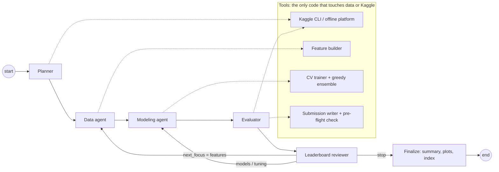

# Kaggle Agent Team

A team of five LLM agents that enters a Kaggle tabular competition on its own: it downloads the data, works out the task and metric, designs features, trains and ensembles models, decides when a result is worth one of the limited daily submissions, reads the leaderboard and plans the next round, until it reaches the target percentile (top 20% by default) or runs out of budget.

```bash
python -m kagent run --config configs/competitions/titanic.yaml
```

Switching competitions is a one-line YAML file: only the Kaggle slug is required.

## Overview

| Agent | Responsibility | Output (validated with pydantic) | Hard guardrails applied after the LLM answers |
|---|---|---|---|
| **Planner** | Reads the data profile, sample submission and the competition's evaluation page. Decides the task, metric, target, id column and submission format. | `CompetitionPlan` | Target must be a train-only column; id must be in the sample submission; metric must match the task; YAML overrides win |
| **Data** | Designs the feature plan: regex extraction from text, dates, frequency encoding, group sizes, ratios, log transforms, log target. It picks transformations; a tool applies them. | `FeaturePlan` | Unknown columns, invalid regexes and bad pairs are removed; RMSLE forces a log target |
| **Modeling** | Proposes a batch of cross-validated experiments (model family and hyperparameters) and whether to ensemble. | `ExperimentBatch` | Params are clipped to bounds; duplicates of past runs are skipped; batch size is capped |
| **Evaluator** | Chooses the most trustworthy candidate and decides whether it deserves a submission. | `SubmitDecision` | No submission after the budget is spent, or unless CV beats the best submitted CV by `min_improvement` |
| **Leaderboard reviewer** (bonus) | Compares CV, public LB and percentile with the target. Diagnoses what is limiting the score and routes the next round to features, models or tuning, with concrete suggestions. | `Review` | Stops when the target is reached or iterations run out |

Every agent has a **deterministic heuristic** with the same output schema. It is used when no LLM is configured (`--llm mock`), when the LLM is unreachable, or when the LLM returns invalid JSON twice. The run never dies because of the model. The log records which path produced each decision (`source: openai:gpt-4o-mini`, `heuristic` or `heuristic-fallback`).

## Architecture



- **Orchestration**: a LangGraph `StateGraph` (`src/kagent/orchestrator/graph.py`). Graph state holds only control flow (iteration, focus, done). DataFrames, features and models live in a shared `Workspace`.
- **LLM interface**: `LLMClient.complete_json(system, user) -> dict` (`src/kagent/llm/`). The OpenAI client uses JSON mode. Adding a provider means adding one class.
- **Agents never execute code they write.** They choose from typed menus (feature operations, model families, bounded params). This keeps the system safe and reproducible, and lets the heuristics and the LLM share one interface. The cost is expressiveness; see Limitations.
- **Observability**:
  - `runs/<competition>/<run_id>/events.jsonl`: every reasoning, decision, tool call, tool result, error and fallback.
  - `llm_calls.jsonl`: full prompts and responses, with tokens and latency.
  - `plan.json`, `feature_plan_v*.json`, `review_it*.json`, `experiments.csv`, `submissions.json` and `summary.json`.
  - `models/*.joblib`: fold models as checkpoints.
  - `plots/*.png`.
  - `runs/index.jsonl`: one line per attempt.

More detail is in [docs/ARCHITECTURE.md](docs/ARCHITECTURE.md).

```
src/kagent/
  agents/          planner, data, modeling, evaluator, reviewer, shared base, schemas
  llm/             interface, OpenAI client, scripted client for tests
  tools/           kaggle (CLI + offline), profile, features, train, metrics, submission, synthetic
  orchestrator/    LangGraph graph + Workspace
  observability/   JSONL run logger
  reporting/       matplotlib evidence
  cli.py           run | demo | list-playground
dashboard/app.py   Streamlit dashboard of attempts, scores and agent decisions
configs/competitions/*.yaml
tests/             offline unit + end-to-end tests
```

## How to run

### 1. Install (Python 3.11+)

```bash
python -m venv .venv && source .venv/bin/activate
make setup                     # pip install -r requirements.txt && pip install -e .
make test                      # offline, no keys needed
```

### 2. Credentials (kept outside the repo)

- **OpenAI:** `cp .env.example .env`, then set `OPENAI_API_KEY`.
- **Kaggle:** go to kaggle.com → Settings → API → *Create New Token*, then save the file as `~/.kaggle/kaggle.json` (`chmod 600`).
- **Competition rules:** open each competition page once and click *Join / I understand and accept*. The API returns 403 until you do.

### 3. Run

```bash
# offline end-to-end, no keys at all (synthetic competition with hidden labels)
python -m kagent demo

# real competition, LLM agents
python -m kagent run --config configs/competitions/titanic.yaml
python -m kagent run --config configs/competitions/house-prices.yaml

# without spending submissions (writes the CSVs only)
python -m kagent run --config configs/competitions/titanic.yaml --no-submit

# heuristic agents only (no OpenAI)
python -m kagent run --config configs/competitions/titanic.yaml --llm mock

make dashboard                 # http://localhost:8501
```

### 4. New competition

Copy `configs/competitions/playground.yaml` and set `competition:` to the slug in the URL (`kaggle.com/competitions/<slug>`). Run `python -m kagent list-playground` to find current episodes. Overrides (`metric`, `target`, `id_column`, `sample_rows`) are optional.

### 5. Docker

```bash
make docker-build
make docker-demo                         # offline
make docker-run COMP=titanic             # mounts ~/.kaggle read-only and passes .env
```

## Demo guide

1. **`make test`** (about 10 s) shows the tools, the guardrails and both offline loops working.
2. **`python -m kagent demo --task regression --target-percentile 0.05 --max-iterations 4`** shows the loop in action. The target is deliberately hard, so the reviewer keeps routing rounds: tuning → models → features. The evaluator holds back submissions that do not clear `min_improvement`, and the run stops on budget.
3. **`python -m kagent run --config configs/competitions/titanic.yaml`** runs on real Kaggle. The console shows each agent's reasoning and decision. Things to watch:
   - The Planner infers the metric from the evaluation page (or the sample submission when the page is unavailable).
   - The Data agent's regex and group-size choices for `Name`, `Ticket` and `Cabin`; this is where the LLM differs most from the heuristic.
   - The Evaluator decides whether to submit.
   - The reviewer compares the percentile to the target and routes the next round.
4. **`make dashboard`**: attempts across competitions, best CV / LB / percentile, experiments, CV vs LB, and an expandable timeline of every agent's reasoning.
5. **Evidence** for the runs reported below is in `runs/evidence/`: event logs, plans, experiments, submissions, plots and summaries.

## Results

| Competition | Metric | Best CV | Public LB | Leaderboard position | Iterations / submissions | Run |
|---|---|---|---|---|---|---|
| synthetic-binary (offline) | ROC AUC ↑ | 0.7735 | 0.7666 | top 6.5% of 400 synthetic teams | 1 / 1 | `runs/evidence/synthetic-binary` |
| synthetic-regression (offline, target top 5%) | RMSLE ↓ | 0.2681 | 0.2710 | top 10.0% of 400 synthetic teams | 4 / 1 | `runs/evidence/synthetic-regression` |
| titanic | accuracy ↑ | _fill after run_ | | | | |
| house-prices-advanced-regression-techniques | RMSLE ↓ | | | | | |

The synthetic leaderboard is generated, not real. Teams are spread between a constant prediction and the noise-free oracle. It exists to test the stopping and routing logic offline. Real positions come from the downloaded Kaggle leaderboard: rank / (teams + 1) at the time of submission.

## Design decisions and trade-offs

- **Typed action space instead of generated code.** The LLM's leverage is in *choices*: which text pattern to extract, which interactions to build, where to tune, when to stop. Generated-code agents can express more, but they fail in ways that are hard to sandbox and to reproduce.
- **Hard rules outside the LLM.** Submission budget, the improvement threshold, param bounds and column validity are enforced in code. The LLM's reasoning is logged next to what the guardrails changed, so overrides are visible.
- **CV is the primary signal; the LB is a check.** The evaluator submits only on CV improvement, which protects against public-LB overfitting and saves daily submissions.
- **Greedy ensemble selection** (Caruana et al., 2004) on out-of-fold predictions. It is cheap and usually beats the best single model. The selection step makes its CV slightly optimistic, which the evaluator is told about.
- **Heuristic parity.** Each agent's heuristic is a real baseline. It makes the system testable offline and gives a measurable bar for what the LLM adds: run the same config with `--llm mock` and with `--llm openai`, then compare.

## Limitations

- Tabular, single-target competitions with a CSV `train / test / sample_submission` layout. No images or text models, no multi-target, and no code competitions (notebook-only submission).
- Feature operations are a fixed menu. Domain-specific transformations outside it are not reachable.
- Large Playground datasets train on `sample_rows` for speed, which costs some accuracy.
- The percentile uses the public leaderboard at submission time. The private leaderboard can differ.
