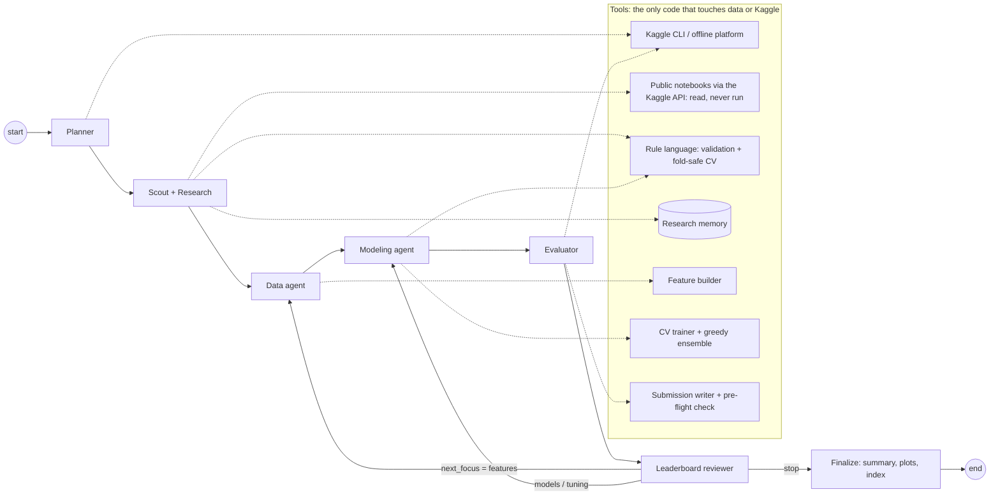

# Kaggle Agent Team

A team of seven LLM agents that enters a Kaggle tabular competition on its own: it downloads the data, works out the task and metric, reads the competition's public notebooks for techniques it can test, designs features, trains and ensembles models, decides when a result is worth one of the limited daily submissions, reads the leaderboard and plans the next round, until it reaches the target percentile (top 20% by default) or runs out of budget.

```bash
python -m kagent run --config configs/competitions/titanic.yaml
```

Switching competitions is a one-line YAML file: only the Kaggle slug is required.

## Overview

| Agent | Responsibility | Output (validated with pydantic) | Hard guardrails applied after the LLM answers |
|---|---|---|---|
| **Planner** | Reads the data profile, sample submission and the competition's evaluation page. Decides the task, metric, target, id column and submission format. | `CompetitionPlan` | Target must be a train-only column; id must be in the sample submission; metric must match the task; YAML overrides win |
| **Scout + Research** | Reads the competition's public notebooks through the Kaggle API, like a person entering a competition: picks what to read from the 100 most voted and 30 best scored, may search, follows each notebook's references, skims, then reads closely the notebooks where rule-shaped techniques appear, and writes them as typed rules (`RuleModel`). Binary tasks only. | `ReadingList`, `ResearchNotes` | Only listed or searched notebooks are read, within `research_notebooks`; notebooks are text, never executed; those reading data from outside the competition are flagged; a rule may only use the competition's columns, its regexes must match and its conditions must match real rows, or it is sent back once with the concrete problems; several independent translations, all valid ones cross-validated |
| **Data** | Designs the feature plan: regex extraction from text, dates, frequency encoding, group sizes, fold-safe group target encoding, ratios, log transforms, log target. It picks transformations; a tool applies them. | `FeaturePlan` | Unknown columns, invalid regexes, bad pairs and group keys that are unique per row are removed; keys whose repeated groups average more than 10 rows are skipped; RMSLE forces a log target |
| **Modeling** | Proposes a batch of cross-validated experiments (model family and hyperparameters) and whether to ensemble. | `ExperimentBatch` | Params are clipped to bounds; duplicates of past runs are skipped; batch size is capped; `group_override` only on binary label metrics with group keys, and always added at its defaults on a new feature set |
| **Evaluator** | Picks a candidate (experiment, rule or ensemble) and decides whether it deserves a submission. | `SubmitDecision` | The candidate is replaced by the simplest one the best-CV candidate does not beat (accuracy: one-sided McNemar on out-of-fold rows, p < 0.05; other metrics: within one standard error), so the LLM's pick can be overridden. No submission after the budget is spent, or unless `cv_lcb` beats the best submitted CV by `min_improvement` |
| **Leaderboard reviewer** (bonus) | Compares CV, public LB and percentile with the target. Diagnoses what is limiting the score and routes the next round to features, models or tuning, with concrete suggestions. | `Review` | Stops when the target is reached or iterations run out; refuses to stop after one round below target; a focus repeated right after it gained no CV is switched |

Every agent has a **deterministic heuristic** with the same output schema (the Research agent's adopts no rule: translating notebooks needs a language model). It is used when no LLM is configured (`--llm mock`), when the LLM is unreachable, or when the LLM returns invalid JSON twice. The run never dies because of the model. The log records which path produced each decision (`source: openai:gpt-4o-mini`, `heuristic` or `heuristic-fallback`).

## Architecture



- **Orchestration**: a LangGraph `StateGraph` (`src/kagent/orchestrator/graph.py`). Graph state holds only control flow (iteration, focus, done). DataFrames, features, models and adopted rules live in a shared `Workspace`. The research node runs once, before the first round.
- **LLM interface**: `LLMClient.complete_json(system, user) -> dict` (`src/kagent/llm/`). The OpenAI-compatible client uses JSON mode and talks to any compatible endpoint through `OPENAI_BASE_URL` (Groq's free tier by default in `.env.example`). Before a run, one tiny preflight call checks the key, URL and model, so a misconfiguration stops the run instead of silently degrading every agent to its heuristic. Reading notebooks is the largest prompt, so the Scout and Research agents can have their own model and quota: `OPENAI_MODEL_RESEARCH`, with optional `OPENAI_MAX_TOKENS_RESEARCH` (output-token ceiling) and `OPENAI_REASONING_EFFORT_RESEARCH`. It gets its own preflight; if that fails, the run goes on with the research memory only. Without it, they use the main model. `summary.json` reports `llm_fallbacks`.
- **Agents never execute code they write or read.** They choose from typed menus (feature operations, model families, bounded params), and a technique found in a notebook is adopted only as a typed rule that a tool evaluates. This keeps the system safe and reproducible, and lets the heuristics and the LLM share one interface. The cost is expressiveness; see Limitations.
- **Observability**:
  - `runs/<competition>/<run_id>/events.jsonl`: every reasoning, decision, tool call, tool result, error and fallback.
  - `llm_calls.jsonl`: full prompts and responses, with tokens and latency.
  - `plan.json`, `research.json` (notebooks listed and read, external reads, techniques, rules), `feature_plan_v*.json`, `review_it*.json`, `experiments.csv`, `submissions.json` and `summary.json`.
  - `models/*.joblib`: fold models as checkpoints (a selected rule is saved as `models/<name>.rule.json`). In `runs/evidence`, every run (rehearsals included) keeps its joblib checkpoints and `models/best_candidate.json`; run 7 (the 332/418 result) also keeps the definition of the rule it submitted (`models/it1_rule_WCG_Model.rule.json`).
  - `plots/*.png`.
  - `runs/<competition>/research_memory.json`: rules validated by earlier research, reused by later runs.
  - `runs/index.jsonl`: one line per attempt.

More detail is in [docs/ARCHITECTURE.md](docs/ARCHITECTURE.md).

```
src/kagent/
  agents/          planner.py, research.py (scout + research), data.py, modeling.py, evaluator.py,
                   reviewer.py, base.py (shared contract), schemas.py (typed outputs, rule language)
  llm/             interface + preflight, OpenAI-compatible client, scripted client for tests
  tools/           kaggle.py (CLI + offline), notebooks.py (notebooks as text), rules.py (rule validation and
                   fold-safe evaluation), memory.py (research memory), profile.py, features.py, train.py,
                   metrics.py, submission.py, synthetic.py
  orchestrator/    LangGraph graph + Workspace
  observability/   JSONL run logger
  reporting/       matplotlib evidence
  cli.py           run | demo | list-playground | kaggle
dashboard/app.py   Streamlit dashboard of attempts, scores and agent decisions
configs/competitions/*.yaml
scripts/           bench_cv.py (offline CV benchmark), make_noise_keys.py (shuffled-key control),
                   seed_research_memory.py (memory from logged Research answers), make_demo_video.py
                   (demo video), diagnostics/ (manual Titanic baselines), plans/ (feature plans used
                   by the benchmarks)
tests/             offline unit + end-to-end tests; e2e/ dashboard browser tests (make e2e)
```

## How to run

### 1. Install (Python 3.12+; evidence produced on 3.14.6, Docker image 3.12)

```bash
python -m venv .venv && source .venv/bin/activate
make setup                     # pip install -r requirements.txt && pip install -e .
make test                      # offline, no keys needed (about a minute)
```

Windows (PowerShell), no `make` needed: `py -3.14 -m venv .venv; .venv\Scripts\Activate.ps1; python -m pip install -r requirements.txt; python -m pip install -e .; python -m pytest -q`. Each Makefile target is one or two `python` commands. `requirements.lock` pins the exact environment the evidence came from (`pip install -r requirements.lock && pip install -e . --no-deps`).

### 2. Credentials (kept outside the repo)

- **LLM:** `cp .env.example .env`, then set `OPENAI_API_KEY`. The example targets Groq (free key at console.groq.com, model `openai/gpt-oss-120b`). For OpenAI, remove `OPENAI_BASE_URL` and set `OPENAI_MODEL=gpt-4o-mini`. The example also gives notebook reading its own Groq model (the three `*_RESEARCH` lines); delete them to use the main model for it.
- **Kaggle** (CLI 2.x): run `kaggle auth login` (OAuth in the browser, no token to manage), or generate a token at kaggle.com/settings/api and save it as `~/.kaggle/access_token` or export `KAGGLE_API_TOKEN`. Check with `python -m kagent kaggle competitions list`. The `kagent kaggle` wrapper is the official CLI verifying TLS against the OS certificate store (as all of `kagent` does through `truststore`), so it also works behind TLS-inspecting antivirus or corporate proxies; use `python -m kagent kaggle auth login` if plain `kaggle auth login` fails with `CERTIFICATE_VERIFY_FAILED`.
- **Competition rules:** open each competition page once and click *Join / I understand and accept*. The API returns 403 until you do.

### 3. Run

```bash
# offline end-to-end, no keys at all (synthetic competition with hidden labels)
python -m kagent demo

# real competition, LLM agents
python -m kagent run --config configs/competitions/titanic.yaml
python -m kagent run --config configs/competitions/house-prices.yaml

# without spending submissions (writes the CSVs only)
python -m kagent run --config configs/competitions/titanic.yaml --no-submit

# heuristic agents only (no OpenAI)
python -m kagent run --config configs/competitions/titanic.yaml --llm mock

make dashboard                 # http://localhost:8501 (RUNS_DIR=runs/evidence for the committed evidence only)
```

**Research** runs on binary tasks, once before the first round: the Scout picks up to `research_notebooks` public notebooks (default 8) and the Research agent writes `research_attempts` independent translations (default 3). Set `research_notebooks: 0` in the YAML to skip reading notebooks. Rules that earlier research validated stay in `runs/<competition>/research_memory.json` and are revalidated and evaluated by every run, with or without reading; delete that file to run without them. With `--llm mock` notebooks are still listed and read, but no new rule is written.

**Reproduce run 7** (the 332/418 result): the research memory is not part of a fresh clone (`runs/` is ignored), so put the committed copy in place, then run as usual (`--no-submit` to keep your daily submissions):

```bash
mkdir -p runs/titanic && cp runs/evidence/titanic-research/research_memory.json runs/titanic/
python -m kagent run --config configs/competitions/titanic.yaml --no-submit
```

The copy holds the rules known after run 7 (run 7 itself started from the 16 seeded ones). To rebuild a memory from the Research agent's logged answers instead: `python scripts/seed_research_memory.py --competition titanic --data data/titanic --target Survived --id-column PassengerId runs/evidence/titanic-research/seed_logs` (the logs keep the answers only, not the notebook text that was sent).

### 4. New competition

Copy `configs/competitions/playground.yaml` and set `competition:` to the slug in the URL (`kaggle.com/competitions/<slug>`). Run `python -m kagent list-playground` to find current episodes. Overrides (`metric`, `target`, `id_column`, `sample_rows`) are optional.

### 5. Docker

```bash
make docker-build
make docker-demo                         # offline
make docker-run COMP=titanic             # mounts ~/.kaggle and passes .env
```

In Docker, OAuth credentials from `kaggle auth login` need write access to refresh; a token (`KAGGLE_API_TOKEN` in `.env`, or `~/.kaggle/access_token`) avoids that.

## Demo guide

1. **`make test`** (about a minute) shows the tools, the guardrails, the research rules and both offline loops working.
2. **`python -m kagent demo --task regression --target-percentile 0.05 --max-iterations 4`** shows the loop in action. The target is deliberately hard, so the reviewer keeps routing rounds: tuning → models → features. The evaluator holds back submissions that do not clear `min_improvement`, and the run stops on budget.
3. **`python -m kagent run --config configs/competitions/titanic.yaml`** runs on real Kaggle. The console shows each agent's reasoning and decision. Things to watch:
   - The Planner infers the metric from the evaluation page (or the sample submission when the page is unavailable).
   - The Scout's reading list and the rules the Research agent writes from it (`research.json`); each valid rule is cross-validated next to the models.
   - The Data agent's regex and group-size choices for `Name`, `Ticket` and `Cabin`; this is where the LLM differs most from the heuristic.
   - The Evaluator decides whether to submit.
   - The reviewer compares the percentile to the target and routes the next round.
4. **`make dashboard`**: attempts across competitions, best CV / LB / percentile, experiments, CV vs LB, and an expandable timeline of every agent's reasoning. `make e2e` drives it in a browser against `runs/evidence` and records a video per test (`runs/evidence/videos`).
5. **Evidence** for the runs reported below is in `runs/evidence/`: event logs, plans, experiments, submissions, checkpoints, plots and summaries. `runs/evidence/kaggle_submissions/` holds each competition's Kaggle submission history as Kaggle reports it (the manual diagnostics are labelled as such). `runs/evidence/video/kagent_titanic_run7.mp4` is a 62-second demo of run 7 (a replay of its event log, then the dashboard), made by `python scripts/make_demo_video.py`. The research prompts in `llm_calls.jsonl` quote excerpts of public Kaggle notebooks, each labelled with its author/slug; that text belongs to its authors.

## Results

Leaderboard positions are where a **new** submission with that score lands on the 2026-10-22 Titanic leaderboard (11,499 teams). Kaggle ranks equal scores by who reached them first, so ties count as ahead: 327/418 shows as top 27.4%, top 20% needs **329/418** (328 lands at 22.2%). `summary.json` files written before this convention was fixed report the optimistic one (327 = 22.2%).

| Competition | Metric | CV of submitted (best CV) | Public | Position | Iterations / submissions | Run |
|---|---|---|---|---|---|---|
| synthetic-binary (offline, heuristic agents) | ROC AUC ↑ | 0.7748 | 0.7666 | top 6.5% of 400 synthetic teams | 1 / 1 | `runs/evidence/synthetic-binary` |
| synthetic-regression (offline, heuristic agents, target top 5%) | RMSLE ↓ | 0.2688 | 0.2710 | top 10.0% of 400 synthetic teams | 4 / 1 | `runs/evidence/synthetic-regression` |
| titanic, run 1 (LLM agents: Groq `openai/gpt-oss-120b`) | accuracy ↑ | 0.8373 (0.8395) | **327/418** | top 27.4% | 4 / 2 (2nd: 322) | `runs/evidence/titanic-groq` |
| titanic, run 2 (repeated CV + `cv_lcb` gate) | accuracy ↑ | 0.8339 | 321/418 | top 73.3% | 4 / 1 | `runs/evidence/titanic-groq-run2` |
| titanic, run 3 (reviewer stall guard) | accuracy ↑ | 0.8395 | 321/418 | top 73.3% | 4 / 1 | `runs/evidence/titanic-groq-run3` |
| titanic, run 4 (group target encoding; LLM chose category keys) | accuracy ↑ | 0.8272 | 311/418 | top 93.6% | 3 / 1 | `runs/evidence/titanic-groq-run4` |
| titanic, run 5 (category keys skipped, heuristic keys used) | accuracy ↑ | 0.8418 | 319/418 | top 84.2% | 1 / 1 | `runs/evidence/titanic-groq-run5` |
| titanic, run 6 (`group_override` + one-SE selection) | accuracy ↑ | 0.8361 (0.8429) | 311/418 | top 93.6% | 4 / 1 (2nd hit the daily limit) | `runs/evidence/titanic-groq-run6` |
| **titanic, run 7 (research: notebooks + research memory; typed rules)** | accuracy ↑ | 0.8406 (0.8451) | **332/418 (0.79425)** | **top 11.0% of 11,490 (target 20%: reached)** | 1 / 1 | `runs/evidence/titanic-groq-run7` |
| titanic (heuristic agents, `--no-submit`) | accuracy ↑ | (0.8418) | | | 4 / 0 | `runs/evidence/titanic-heuristic` |
| house-prices-advanced-regression-techniques (LLM agents: `openai/gpt-oss-20b`) | RMSLE ↓ | 0.1265 (0.1250) | 0.12715 | top 34.7% of 4,385 (target 20%: not reached) | 4 / 2 (1st: 0.13692) | `runs/evidence/house-prices-run1` |
| spaceship-titanic (LLM agents: `openai/gpt-oss-20b`; the config names no target, metric or id) | accuracy ↑ | 0.7959 | 0.79074 | top 79.6% of 1,724 (target 20%: not reached) | 2 / 1 | `runs/evidence/spaceship-titanic-run1` |

**Target: reached by the agent team in run 7: 332/418, top 11.0%.** The Scout and Research agents read public notebooks (live research that run also translated a faithful rule on its own), the research memory carried the rules earlier research had validated, and the Evaluator submitted the woman-child-group rule (CV 0.8406, complexity 4) because the best boosted model (CV 0.8451) is not significantly better on the same rows; the reviewer then stopped on target. Runs 1-6, without research, peaked at 327/418 (top 27.4%). Nothing used leaked labels or multiple accounts. The decisions made after seeing public scores are listed below; run 7's score measures the pipeline as designed after them, not an independent test of those decisions.

**Other competitions.** Both ran from a short config that names no target, metric, id or submission format (slug, target percentile and budget); the Planner inferred them (Spaceship's target is a True/False column, House Prices is RMSLE regression with a log target). Neither reached the top 20%. Spaceship Titanic ran on its first attempt with no code change. House Prices did not: its first attempt (not kept) crashed after the Data agent's LLM request on the 81-column profile exceeded the free tier's size, because the shortened profile had dropped `SalePrice` and the Data heuristic could not find the target; the profile was made smaller and now always keeps the target and submission columns (commit `b42e249`), and the run reported here started after that fix. In it, the Data agent's LLM returned invalid JSON twice and the heuristic was used; House Prices improved from 0.13692 to 0.12715 between its two submissions and used the whole budget. Spaceship Titanic stopped after two rounds because the reviewer LLM read its top-79.6% position as "well above the target", a reasoning error the guardrails let through (they only refuse a stop below target before two rounds exist). Research ran on Spaceship Titanic and adopted no rule, which is what its notebooks support; it is skipped on regression.

**Human involvement, in the order it happened.** The Titanic work was not hands-off, and the later changes were made knowing public scores:
1. After runs 1-3 (public 321-327), a multi-agent workflow researched leak-free Titanic techniques, implemented three levers in isolated worktrees and had adversarial verifiers reproduce them; only fold-safe group target encoding was kept (+0.6 to +0.7 `cv_lcb` over 5 CV seeds). A one-standard-error selection rule was rejected then (across model families it lost 1.24 ± 0.49 points against `cv_lcb` on 20 held-out splits).
2. Runs 4-5 showed the LLM using category keys (ticket prefix, cabin letter) for the encoding, which lets a model read training labels back (CV 0.847 → 0.827, public 311). Keys whose repeated groups average more than 10 rows are now skipped; the threshold of 10 was set from run 4's keys (12 and 42).
3. After all seven agent submissions, three manual baselines were submitted to test why the agents stall (below). Their definitions were fixed before their own scores were seen, but the woman-child-group (WCG) rule is a published notebook (C. Deotte) known for its public score.
4. After the WCG baseline scored 334, `group_override` was written in the shape of that rule (a shallow tree changed only where a row's group is unanimous), its defaults chosen on Titanic CV, and the orchestrator made to always evaluate it. After run 6 (311), category handling was changed (CART ordering, rare levels to the prior) and the Evaluator rule was changed to "the simplest candidate the best-CV candidate does not beat with a one-sided McNemar test, p < 0.05, on the same out-of-fold rows". **That rule was adopted after seeing that, on a local run, it selects `group_override`.** An adversarial review found no label leakage (flipped validation labels change no prediction; shuffled labels give CV 0.605-0.614 against a majority rate of 0.616), and found that the test leans towards complex candidates when the lead is the best of ~20 estimates (P(p < 0.05) = 0.22 instead of 0.05 under the null).

5. After the user asked for the agents to learn the way most top-20% teams did, by reading public notebooks, a Scout and a Research agent were added (step above, in the agents table) with a typed rule language that can express the public woman-child-group tutorial exactly. Then, after seeing local results: the research got a separate model (Groq free-tier quotas), reference following, a skim-then-close-read pass, data-aware validation with one repair round and several translations, and the complexity count was changed to include every fitted piece (group_override's cell tree), which makes an adopted rule simpler than group_override.

Measured locally, without submitting: the Scout reached the tutorial (`cdeotte/titanic-wcg-xgboost-0-84688`, 57th by votes) and followed its references to the notebooks that define the rule; in 3 of 5 research executions that got LLM answers at least one translated rule was within 2 test rows of the scored WCG file (CV 0.8406, complexity 4), the others produced looser rules (CV 0.78-0.82); with a faithful rule among run 5's candidates, the Evaluator picks it (the best boosted model is not significantly better, McNemar p = 0.37). A file within 2 rows of a file scored 334/418 scores at least 332/418 (top 20% needs 329). The research depends on the LLM: on Groq's free tier each model allows 200k tokens a day and a run's research takes about 40k.

Because the translation varies between calls, rules that research validates are kept in a **research memory** (`runs/<competition>/research_memory.json`, copy in `runs/evidence/titanic-research`) and every later run revalidates and evaluates them, adding what its own research finds; `scripts/seed_research_memory.py` rebuilt the Titanic memory from the Research agent's logged answers of the day (16 valid rules at the time, 4 of them within 2 rows of the WCG file; the answers are in `runs/evidence/titanic-research/seed_logs`, and rebuilding from them with today's stricter validation keeps 18 rules after run 7's own). Cross-validation ranks those translations correctly: the faithful ones have the highest CV (0.8406) of the 16. Local rehearsals without submitting (`runs/evidence/titanic-research/rehearsal-*`): with heuristic agents and with LLM agents, the team submitted a faithful rule from iteration 1 (in the LLM run the guard also replaced the LLM's later LightGBM picks by it); the selected files bound to 332-334/418, top 11% or better.

Any Titanic score submitted after step 4 measures this author-designed pipeline, not an autonomous discovery by the agents, and is not independent confirmation of the rule.

**Why the agent team stops near 0.77: what was tested.**

| Model | CV (3×5) | Public | Position |
|---|---|---|---|
| gender rule (no fitted parameter) | 0.7868 | 320/418 | top 81.4% |
| shallow random forest, 6 features | 0.8358 | 324/418 | top 61.4% |
| agent team, 7 submissions | 0.827-0.842 | 311-327 | top 27.4-93.6% |
| WCG rule (gender + 16 unanimous-group overrides, train labels only) | 0.8417 | **334/418** | **top 8.7%** |

- CV does not rank these models: the WCG rule and the agents' best-CV model have the same CV (0.8417 vs 0.8418) and differ by 15 passengers on the public test (55 differing rows, 35-20, two-sided sign test p = 0.058; against the agents' best public file, 327, p = 0.38). This is consistent with a model-class effect that CV cannot see, but does not by itself establish one. Across the agents' 7 submissions, Spearman ρ(CV, public) = 0.36 (p = 0.43).
- The CV-public gap is 2.1 points for the gender rule, 4.3 for WCG, 6.1 for the 6-feature forest and 5.5-9.2 for the agents' 7 submissions.
- Not leakage from random folds: a validation row shares a ticket with training rows 34% of the time, a test row 36%; grouping folds by ticket costs 0.6 points of CV.
- Not drift: adversarial validation AUC train vs test = 0.51.
- Leaderboard noise: one binomial standard error is 8.5 passengers; 327 is not distinguishable from 319-322 (sign test on the differing rows, p = 0.23-0.38), only from 311 (p = 0.014).
- `group_override` after the review fixes: CV 0.830 on average over the LLM's own feature plans and two CV seeds (minimum 0.827) against 0.8417 for the hand-specified rule; its test predictions differ from the WCG file in 20 rows, which bounds their public score to 314-346 without submitting. With these fixes, a local run (heuristic agents, no submission) no longer selects it: LightGBM (CV 0.847) beats it on the paired test, so the Evaluator picks boosted trees again, whose files bound to 299-349.

**LLM vs heuristic.** Under the same nested CV, the differences (best single 0.8373 vs 0.8350, ensemble 0.8395 vs 0.8418) are well inside the fold std (~0.02). On a dataset this small, the LLM's measurable contribution is the quality and traceability of its choices, not CV. Reasoning errors seen in the logs, which guardrails do not catch: the reviewer read the CV-LB gap as overfitting and then asked for more capacity; the reviewer suggested CatBoost/XGBoost, which are outside the typed menu; the Evaluator read a higher in-sample ensemble CV as evidence *against* overfitting.

The synthetic leaderboard is generated, not real. Teams are spread between a constant prediction and the noise-free oracle. It exists to test the stopping and routing logic offline. Real positions come from the downloaded Kaggle leaderboard: rank / (teams + 1) at the time of submission.

## Design decisions and trade-offs

- **Typed action space instead of generated code.** The LLM's leverage is in *choices*: which text pattern to extract, which interactions to build, where to tune, when to stop. Generated-code agents can express more, but they fail in ways that are hard to sandbox and to reproduce.
- **Hard rules outside the LLM.** Submission budget, the improvement threshold, param bounds and column validity are enforced in code. The LLM's reasoning is logged next to what the guardrails changed, so overrides are visible.
- **CV is the primary signal; the LB is a check.** The evaluator submits only on CV improvement, which protects against public-LB overfitting and saves daily submissions.
- **Uncertainty-aware submissions.** Below 5,000 train rows CV is repeated 3 times with new shuffles (`cv_repeats`), because one 5-fold split is noisier than the differences between candidates (Titanic fold std ~0.02). Every candidate carries `cv_lcb`, its CV moved one standard error towards worse; the hard gate only allows a submission when `cv_lcb` beats the best submitted CV. This came from the first Titanic run, where an ensemble with +0.2 points of CV and the widest fold spread was submitted and lost 5 passengers on the leaderboard.
- **Greedy ensemble selection** (Caruana et al., 2004) on out-of-fold predictions. It is cheap and often beats the best single model. Its CV is nested (weights re-selected on k-1 folds of the OOF rows, scored on the held-out fold), because scoring it on the rows that chose its weights overstates it (Titanic accuracy: 0.846 in-sample vs 0.840 nested; the honest gain over the best single model is still +1.8 points). On pure-noise members the in-sample estimate reports a gain that does not exist, which the tests check. The in-sample number stays in `params.in_sample_cv`.
- **Fold-safe group target encoding.** Rows that share a key (a ticket, a booking, a household; a raw column or a regex-extracted part of one, such as a surname) often share the outcome. `group_target_encoding` gives each row the mean target of the *other* labelled members of its group, how many there are (0 = no information, unlike "all died") and the group size. `build_features` only assigns group ids; the statistics are computed inside `run_cv` for every fold from that fold's training rows, so a row's own label never enters its own group statistic (smoothing shrinks towards one fold-wide mean, never a per-row one, which would encode the row's label) and validation rows are encoded exactly like test rows. Controls: the same keys shuffled across rows (`scripts/make_noise_keys.py`, same cardinality and group sizes) give no CV gain, and a naive encoding that includes the row's own label gains 10+ points in the unit test, so the test can catch a leak. On Titanic with the LLM's own feature plan, encoding the ticket raises the bench's best `cv_lcb` by +0.6 to +0.7 points on average over 5 CV seeds, positive on all 5 (+0.84 at seed 42: 0.8428 → 0.8512; the ticket key was also the best of 8 variants compared, so read the top number as optimistic), against a loss for the shuffled ticket (0.8367 on average at seed 42). The heuristic Data agent proposes it for high-cardinality text that repeats in train and reappears in test (`test_seen_pct` in the profile).
- **Heuristic parity.** Each agent's heuristic is a real baseline. It makes the system testable offline and gives a measurable bar for what the LLM adds: run the same config with `--llm mock` and with `--llm openai`, then compare.

## Limitations

- Tabular, single-target competitions with a CSV `train / test / sample_submission` layout. No images or text models, no multi-target, and no code competitions (notebook-only submission).
- Feature operations are a fixed menu. Domain-specific transformations outside it are not reachable.
- Research adopts only rules of one shape (majority class per value of one column, plus unanimous-group overrides) and only on binary tasks; other techniques it reads are listed in `research.json` but not used.
- Large Playground datasets train on `sample_rows` for speed, which costs some accuracy.
- The percentile uses the public leaderboard at submission time. The private leaderboard can differ.
