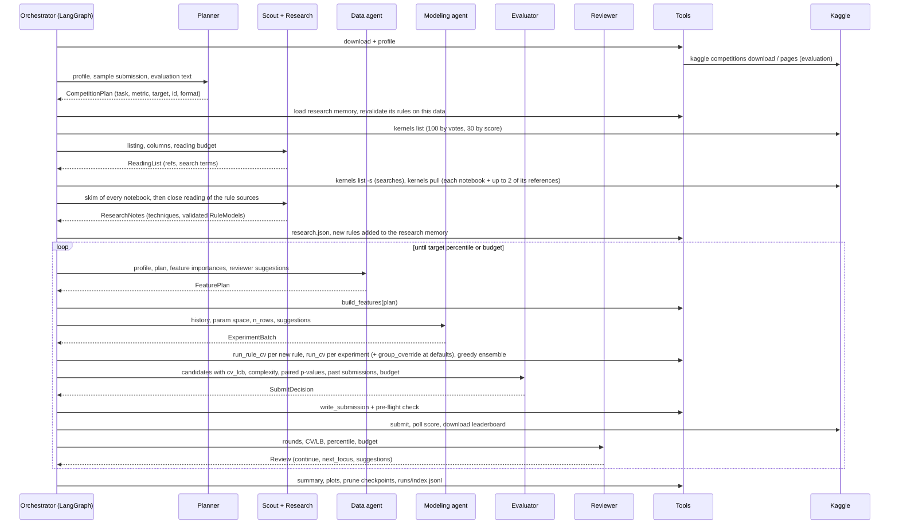

# Architecture

## 1. The graph, step by step

LangGraph nodes: `planner → research → data → modeling → evaluator → reviewer`, then the reviewer routes to `data`, `modeling` or `finalize`.



The research node runs once, before the first round, and only on binary tasks (rules predict 0/1). Its rules are cross-validated in the first modeling round, each once, and compete with the models from then on. `next_focus = features` returns to the Data agent; a new feature version is built and every model family is re-run on it. `models` and `tuning` return to the Modeling agent on the current features.

## 2. State vs workspace

| | Holds | Why |
|---|---|---|
| `GraphState` (LangGraph) | `iteration`, `focus`, `done` | Routing only; small and serialisable |
| `Workspace` (dataclass) | config, platform, logger, LLM and optional research LLM, DataFrames, profile, plan, feature matrix and version, adopted rules, experiment results (OOF + test predictions), selected candidate, submissions, rounds, leaderboard, reviewer suggestions | Large or unserialisable objects shared by nodes |

## 3. Agent contract (`agents/base.py`)

```
decide(ctx):
    if llm:   answer = llm.complete_json(role + JSON schema, ctx)  -> pydantic validate
              on invalid JSON / validation error: one repair retry with the errors attached
              on second failure or LLM outage: log `fallback`
    if no answer: answer = heuristic(ctx)
    answer, notes = guard(answer, ctx)        # hard rules, logged as `guardrails`
    log reasoning + decision (with source: openai:<model> | heuristic | heuristic-fallback)
```

Context keys starting with `_` (e.g. the train+test data the Research guard validates rules against) reach the guard, never the prompt. Agents do not call tools themselves. Each agent returns a typed decision, and the orchestrator node runs the corresponding tool. Every tool call and its result are logged. This keeps the agents pure and easy to test (`tests/test_agents.py` and `tests/test_research.py` drive them with a scripted LLM).

The Research agent extends `decide`: it makes `research_attempts` independent calls (the same notebooks often come out as a faithful rule on one call and a looser one on another); a call whose guard rejects rules gets one repair call with the rejected rules and their concrete problems; valid rules from all calls are merged by content (name and provenance ignored).

## 4. Guardrails

| Agent | Rule | Where |
|---|---|---|
| Planner | Target ∈ train-only columns; id ∈ sample submission; metric consistent with task; YAML overrides win; submission format re-derived after overrides | `planner.py::guard` |
| Scout | Only refs from the listing or from its own searches are read (others dropped and logged); ≤ `research_notebooks` picks, ≤ 3 search terms (top 2 hits each); the orchestrator reads at most `research_notebooks` + 4 notebooks plus ≤ 8 followed references (≤ 2 per notebook) | `research.py::NotebookScoutAgent.guard`, `graph.py::live_research` |
| Research | Notebook text is data: never executed, and the prompt says to ignore instructions in it; notebooks reading files from outside the competition are flagged (`external_reads`) in the prompt and in `research.json`; no rules on non-binary tasks; a rule must use known columns (raw or derived), regexes that compile with exactly one capture group, 0/1 outcomes and, checked on train+test, regexes and `==`/`in` conditions that match at least one row; rejected rules go back once with their problems | `research.py::ResearchAgent.guard`, `rules.py::validate_rule`, `notebooks.py::external_reads` |
| Data | Columns must exist with the right type; regex must compile with ≥ 1 capture group; ≤ 20 ratios, ≤ 10 group sizes; ≤ 5 group target encodings whose keys exist (raw or regex-derived), are not unique per row and whose outputs do not collide with other features; keys whose repeated groups average more than 10 rows are skipped (a category, not groups of related rows); if every proposed encoding is rejected, the heuristic's keys are used; never drop everything; RMSLE ⇒ log target; no log target outside regression | `features.py::validate_plan`, `features.py::build_features`, `data.py::guard`, `graph.py::data_node` |
| Modeling | Params clipped to `PARAM_SPACE` bounds, unknown params ignored; duplicates of past (model, params, feature version) skipped; batch ≤ `max_experiments_per_iteration`; no forests above 200k rows; `group_override` only on binary tasks with accuracy or F1 and group keys; the orchestrator adds `group_override` at its defaults on every new feature set where it is available | `train.py::clip_params`, `modeling.py::guard`, `graph.py::modeling_node` |
| Evaluator | Simplest-not-beaten rule (section 5); submissions ≤ `max_submissions`; submit only when `cv_lcb` beats the best submitted CV by `min_improvement`; candidate must exist; submission must pass the pre-flight check (columns, rows, no NaN) | `evaluator.py::guard`, `submission.py::check_submission` |
| Reviewer | Stop when the percentile ≤ target or no iterations are left; a stop after a single round, below target and with iterations left, is refused; a focus whose last round gained no CV is switched to the area left untouched the longest; `continue` and `next_focus` kept consistent | `reviewer.py::guard` |

## 5. Candidate selection

Candidates are every experiment, every rule and every nested ensemble. Each carries `cv_score`, `cv_lcb` (CV moved one standard error towards worse, the submit gate's number), `cv_se1` (fold std / √folds per repeat) and `complexity`, a rough count of fitted decisions:

| Candidate | Complexity |
|---|---|
| LightGBM / HistGB | leaves × trees |
| Random forest / extra trees | trees × 2^min(depth, 12) |
| Linear | number of features |
| `group_override` | base-tree leaves + cell-tree leaves (when deeper) + mean accepted overrides |
| Rule | distinct `base_column` values in train + number of overrides |
| Ensemble | sum over its members |

For accuracy, `p_best_better` is a one-sided exact McNemar test (`train.py::paired_p_better`) that the best-CV candidate is more accurate than this one on the same out-of-fold rows; rules, models and `group_override` share the same stratified splits. The Evaluator sees the top 8 by CV plus every candidate the best does not significantly beat (without p-values: within one `cv_se1` of it), so the simplest is never cut. The hard rule (`evaluator.py::simplest_tied`): among candidates with `p_best_better` ≥ 0.05, the one with the lowest complexity (ties: best CV); for other metrics, among candidates within one `cv_se1` of the best CV. An LLM pick that is beaten, or more complex than that candidate, is replaced by it. The README (Human involvement, step 4) records when this rule was adopted and its bias when the lead is the best of many estimates.

## 6. Research

### Reading (`graph.py::live_research`, `tools/notebooks.py`)

- **Listing:** `kaggle kernels list --competition`, 100 by votes and 30 by score, deduplicated. The Scout picks what to read and may add searches.
- **Pulling:** `kaggle kernels pull` into `data/<competition>/_notebooks/<owner>__<slug>/`. `.ipynb`/`.irnb` are split into markdown and code cells; scripts (`.py`, `.r`, `.Rmd`) are read whole. Nothing is executed. Up to two Kaggle notebooks linked from each notebook's markdown are followed and read right after it.
- **External data:** read calls (`read_csv`, `open`, `fread`...) on files that are not the competition's own, and data URLs, are listed as `external_reads`. Such notebooks stay in the reading, flagged, because their reported scores may not be reachable with the competition's data alone.
- **Skim, then close reading:** the Research agent first sees the opening 1,100 characters (prose and code) of up to 13 notebooks, then up to 4,000 characters of at most 3 notebooks where it found rule-shaped techniques, valid or not; exact column definitions sit deeper than a skim reaches. Rules from both passes are merged by content, at most 6.

### Rule language (`agents/schemas.py`, `tools/rules.py`)

- **`Condition(column, op, value)`**: `==`, `!=`, `in`, `not_in`, `<`, `<=`, `>`, `>=`, `isna`, `notna` on a raw or derived column.
- **`GroupOverride(when, group_keys, members_when, min_group_size, if_all, set_to)`**: rows matching every `when` condition are set to `set_to` if every other labelled member of their group had outcome `if_all`. A group is the rows sharing the `group_keys` values among those matching `members_when` (OR of AND-lists; empty = every row), with at least `min_group_size` members over train+test.
- **`RuleModel(name, derive, base_column, overrides, source, reported_public_score)`**: `derive` adds regex columns (one capture group); the base prediction is the training majority class of each `base_column` value (unseen values: the overall training rate); overrides apply in order.
- **Fold-safe evaluation:** `predict_rule(rule, full, y, known, rows)` reads labels of the `known` rows only, and takes a known row's own label out of its group's statistic. `run_rule_cv` cross-validates with the same folds, seed and repeats as the models and predicts test with all training labels; the result is an `ExperimentResult` with `model = "rule"`, which can also join an ensemble. A test flips the labels of the predicted rows and checks that no prediction changes.

### Research memory (`tools/memory.py`)

`runs/<competition>/research_memory.json` holds a list of `{rule, found_in, model}` entries (the run, or the log, the rule came from, and the LLM that wrote it). At the start of the research node every remembered rule is revalidated on the current data; invalid ones are skipped. Valid rules from this run's research are appended when their content (ignoring name and provenance) is new. The rules evaluated are remembered + new, deduplicated by content, with unique names. The memory only makes rules candidates: selection is still CV plus section 5. `scripts/seed_research_memory.py` rebuilds a memory from the Research agent's logged answers in `llm_calls.jsonl`.

## 7. Group features

**`group_target_encoding`** (`tools/features.py`). A `FeaturePlan` entry names keys (raw or regex-derived columns), `min_group_size` and `smoothing`. `build_features` only assigns group ids (a missing key part or a group below `min_group_size` over train+test means no group) and adds `<name>_size`. Inside every fold, `run_cv` calls `group_target_encode`: `<name>` = mean target of the *other* labelled members, from training-fold rows only (one column per class for multiclass), `<name>_n` = how many there are. Validation and test rows are encoded from all training-fold rows, training rows from the other training rows; smoothing shrinks towards one fold-wide prior, never a per-row one.

**`group_override`** (`tools/train.py`). Binary tasks with accuracy or F1, using the plan's group keys. Per fold: categories are ordered by their training positive rate (rare levels get the prior); a depth-1..3 tree gives the base prediction; for each (cell, outcome) of a second tree of depth `cell_depth` (the base tree when not deeper), the override "rows of this cell whose other group members all had this outcome get it" is accepted only if, on training rows judged by their group-mates without their own label, it is right more often than wrong with 95% confidence (Wilson lower bound > 0.5, at least 3 rows). `member_purity`, `member_min_rate` and `min_known` restrict which group-mates count as evidence. Defaults: `depth` 1, `cell_depth` 2, `min_known` 1, `member_purity` 1.0, `member_min_rate` 0.0.

## 8. Failure handling

| Failure | Behaviour |
|---|---|
| LLM rate limit (429) or network error | The OpenAI client retries with backoff (`max_retries=5`); if the call still fails, the agent tries once more, then uses its heuristic; `error` + `fallback` events |
| LLM misconfigured (key, base URL, model) | The preflight call fails and the run stops with a message naming the `.env` variables, instead of becoming a heuristic-only run |
| Research model unavailable | Its own preflight fails: live research is switched off (`research_notebooks = 0`) rather than moved onto the main model's quota, and the run uses the research memory; `fallback` event |
| LLM returns malformed or invalid JSON | One repair retry with the validation errors, then heuristic |
| Rule fails validation | One repair call with the concrete problems; still invalid → dropped, listed in the guardrail notes |
| Live research raises | Logged; the run continues with the remembered rules |
| Notebook listing or pull fails | Empty listing: no live research. Failed pull: notebook skipped, `error` event |
| Kaggle CLI prints warning lines before its CSV (e.g. an outdated-version notice) | `csv_from_cli` starts at the header row (submission scores, notebook listings) |
| Feature plan crashes the builder | Keep the previous feature set, or use the heuristic plan on the first round |
| Every proposed group target encoding rejected | The heuristic's keys are used; `fallback` event |
| One experiment or rule fails to run | Logged and skipped; the round continues |
| Submission fails the pre-flight check | `error` event; nothing is submitted that round |
| Kaggle 403 (rules not accepted) | Clear error with the hint to accept the rules |
| Submit fails or score still pending after the poll timeout (300 s) | Logged; the run continues; percentile unknown for that submission |
| Leaderboard download unavailable | Percentile reported as unknown; the reviewer then works from CV only |

## 9. Logs (`runs/<competition>/<run_id>/`)

`events.jsonl` has one JSON object per line:

```json
{"ts": "...", "elapsed_s": 13.2, "run_id": "...", "competition": "titanic", "iteration": 2,
 "agent": "evaluator", "event": "decision", "message": "SUBMIT it2_ensemble",
 "data": {"source": "openai:gpt-4o-mini", "decision": {...}, "guardrails": []}}
```

Event types: `reasoning`, `decision`, `tool_call`, `tool_result`, `error`, `fallback`.

The other files in the run folder are:

| File | Content |
|---|---|
| `llm_calls.jsonl` | System prompt, user context, raw response, tokens and latency for every LLM call (main and research model) |
| `plan.json` | The Planner's decision |
| `research.json` | Notebook listing, notebooks read with their `external_reads`, techniques, adopted rules (written when live research read at least one notebook) |
| `feature_plan_v<N>.json` | One file per feature set |
| `review_it<N>.json` | The reviewer's decision per round |
| `experiments.csv` | Every candidate (experiment, rule, ensemble), with CV, `cv_lcb`, `cv_se1` and complexity |
| `submissions.json` | Every submission with CV, LB and percentile |
| `summary.json` | Run summary, including best and selected candidate and `llm_fallbacks` |
| `submissions/*.csv` | Submission files |
| `models/*.joblib` | Fold models of the best and the selected candidate, plus `best_candidate.json` |
| `leaderboard/` | The public leaderboard, downloaded after the first submission |
| `plots/*.png` | CV per experiment, best-so-far, CV vs LB |

Outside the run folder: `runs/<competition>/research_memory.json` (section 6), and `runs/index.jsonl`, which appends one summary per run and is what the dashboard lists.

## 10. Extending

- **New LLM provider:** implement `complete_json(system, user) -> dict` and register it in `llm/__init__.py::make_llm`.
- **New model family:**
  - Add its bounds to `PARAM_SPACE`.
  - Add a branch in `_estimator` (and `_prepare` if it needs numeric input).
  - Add its complexity to `model_complexity` (an unknown family counts as 0, the simplest).
  - Add its name to `ModelName` in `schemas.py`.
- **New feature operation:**
  - Add a field to `FeaturePlan`.
  - Validate it in `validate_plan` and apply it in `build_features`.
  - The agents see it automatically through the JSON schema in their prompt.
- **New rule shape:** add fields to `Condition`, `GroupOverride` or `RuleModel`, check them in `validate_rule` and apply them in `predict_rule`; the Research agent sees them through the schema.
- **New agent:**
  - Subclass `Agent[YourSchema]` with `role`, `heuristic` and `guard`.
  - Add a node and edges in `orchestrator/graph.py`.

## 11. Testing

`make test` runs offline in about a minute:

- **Tools:** metrics and direction, percentile, param clipping, plan validation, the feature → train → ensemble → submission → offline-score round trip, integer label dtype, nested ensemble CV, Kaggle CSV parsing after warning lines, the group target encoding's fold safety (a row's own label never changes its own value; shuffled keys give no CV gain while a naive encoding does; category keys with big groups are skipped), and `group_override` (never reads a validation or own label; shuffled labels stay at the majority rate; shuffled keys are ignored).
- **Agents with a scripted LLM:** hallucinated target, id and metric corrected by the guards; invalid JSON and outages falling back; the preflight failing loudly; the evaluator unable to exceed its budget or submit without improvement, and replacing a pick by the simplest candidate not beaten (paired test or one standard error); the reviewer stopping at the target, refusing to stop after one round and leaving a stalled focus.
- **Research:** external reads flagged; a rule never reads the labels of the rows it predicts; validation catching translation errors (values that match no row); one repair round; valid rules kept from several attempts; the Scout limited to listed refs; notebook rules becoming cross-validated candidates in a full run; the research memory carrying a rule into a later run without an LLM or notebooks.
- **End to end:** binary and regression loops on generated competitions. These check that every agent logged a decision and that the artifacts exist: plan, experiments, summary, plots, checkpoints and the index.

`make e2e` (not part of `make test`) drives the Streamlit dashboard in a browser against `runs/evidence` with Playwright and records a video per test.
