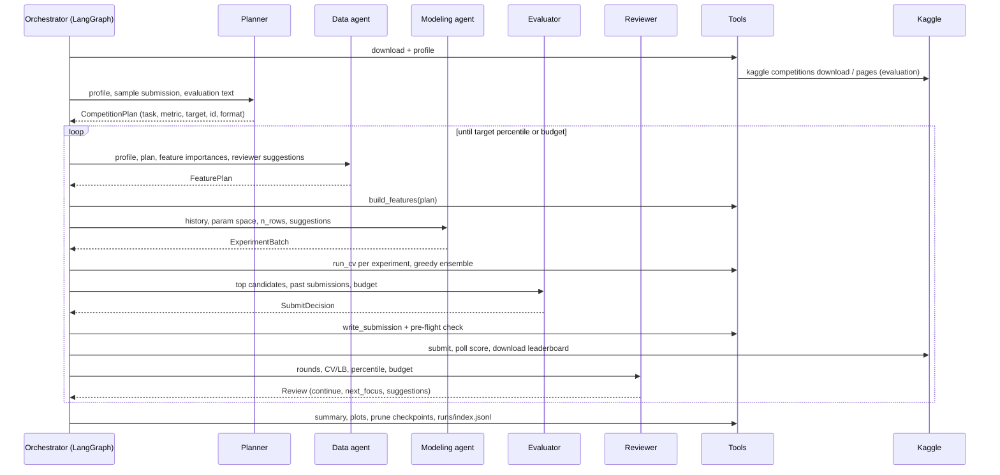

# Architecture

## 1. One round, step by step



`next_focus = features` returns to the Data agent; a new feature version is built and every model family is re-run on it. `models` and `tuning` return to the Modeling agent on the current features.

## 2. State vs workspace

| | Holds | Why |
|---|---|---|
| `GraphState` (LangGraph) | `iteration`, `focus`, `done` | Routing only; small and serialisable |
| `Workspace` (dataclass) | config, platform, logger, LLM, DataFrames, profile, plan, feature matrix and version, experiment results (OOF + test predictions), submissions, rounds, leaderboard, reviewer suggestions | Large or unserialisable objects shared by nodes |

## 3. Agent contract (`agents/base.py`)

```
decide(ctx):
    if llm:   answer = llm.complete_json(role + JSON schema, ctx)  -> pydantic validate
              on invalid JSON / validation error: one repair retry with the errors attached
              on second failure or LLM outage: log `fallback`
    if no answer: answer = heuristic(ctx)
    answer, notes = guard(answer, ctx)        # hard rules, logged as `guardrails`
    log reasoning + decision (with source: openai:<model> | heuristic | heuristic-fallback)
```

Agents do not call tools themselves. Each agent returns a typed decision, and the orchestrator node runs the corresponding tool. Every tool call and its result are logged. This keeps the agents pure and easy to test (`tests/test_agents.py` drives them with a scripted LLM).

## 4. Guardrails

| Agent | Rule | Where |
|---|---|---|
| Planner | Target ∈ train-only columns; id ∈ sample submission; metric consistent with task; YAML overrides win; submission format re-derived after overrides | `planner.py::guard` |
| Data | Columns must exist with the right type; regex must compile with ≥ 1 capture group; ≤ 20 ratios, ≤ 10 group sizes; ≤ 5 group target encodings whose keys exist (raw or regex-derived) and are not unique per row; never drop everything; RMSLE ⇒ log target; no log target outside regression | `features.py::validate_plan`, `data.py::guard` |
| Modeling | Params clipped to `PARAM_SPACE` bounds, unknown params ignored; duplicates of past (model, params, feature version) skipped; batch ≤ `max_experiments_per_iteration`; no forests above 200k rows | `train.py::clip_params`, `modeling.py::guard` |
| Evaluator | Submissions ≤ `max_submissions`; submit only when CV beats the best submitted CV by `min_improvement`; candidate must exist; submission must pass the pre-flight check (columns, rows, no NaN) | `evaluator.py::guard`, `submission.py::check_submission` |
| Reviewer | Stop when the percentile ≤ target or no iterations are left; `continue` and `next_focus` kept consistent | `reviewer.py::guard` |

## 5. Failure handling

| Failure | Behaviour |
|---|---|
| OpenAI down, rate-limited or no key | Agent falls back to its heuristic; `error` + `fallback` events |
| LLM returns malformed or invalid JSON | One repair retry with the validation errors, then heuristic |
| Feature plan crashes the builder | Keep the previous feature set, or use the heuristic plan on the first round |
| One experiment fails to train | Logged and skipped; the round continues |
| Kaggle 403 (rules not accepted) | Clear error with the hint to accept the rules |
| Submit fails or score still pending after the poll timeout | Logged; the run continues; percentile unknown for that submission |
| Leaderboard download unavailable | Percentile reported as unknown; the reviewer then works from CV only |

## 6. Logs (`runs/<competition>/<run_id>/`)

`events.jsonl` has one JSON object per line:

```json
{"ts": "...", "elapsed_s": 13.2, "run_id": "...", "competition": "titanic", "iteration": 2,
 "agent": "evaluator", "event": "decision", "message": "SUBMIT it2_ensemble",
 "data": {"source": "openai:gpt-4o-mini", "decision": {...}, "guardrails": []}}
```

Event types: `reasoning`, `decision`, `tool_call`, `tool_result`, `error`, `fallback`.

The other files in the run folder are:

| File | Content |
|---|---|
| `llm_calls.jsonl` | System prompt, user context, raw response, tokens and latency for every LLM call |
| `plan.json` | The Planner's decision |
| `feature_plan_v<N>.json` | One file per feature set |
| `review_it<N>.json` | The reviewer's decision per round |
| `experiments.csv` | Every experiment |
| `submissions.json` | Every submission with CV, LB and percentile |
| `summary.json` | Run summary |
| `submissions/*.csv` | Submission files |
| `models/*.joblib` | Fold models of the best candidate, plus `best_candidate.json` |
| `plots/*.png` | CV per experiment, best-so-far, CV vs LB |

`runs/index.jsonl` appends one summary per run, which is what the dashboard lists.

## 7. Extending

- **New LLM provider:** implement `complete_json(system, user) -> dict` and register it in `llm/__init__.py::make_llm`.
- **New model family:**
  - Add its bounds to `PARAM_SPACE`.
  - Add a branch in `_estimator` (and `_prepare` if it needs numeric input).
  - Add its name to `ModelName` in `schemas.py`.
- **New feature operation:**
  - Add a field to `FeaturePlan`.
  - Validate it in `validate_plan` and apply it in `build_features`.
  - The agents see it automatically through the JSON schema in their prompt.
- **New agent:**
  - Subclass `Agent[YourSchema]` with `role`, `heuristic` and `guard`.
  - Add a node and edges in `orchestrator/graph.py`.

## 8. Testing

`make test` runs offline in about 10 s:

- **Tools:** metrics and direction, percentile, param clipping, plan validation, the feature → train → ensemble → submission → offline-score round trip, integer label dtype, Kaggle CSV parsing, and the group target encoding's fold safety (a row's own label never changes its own value; shuffled keys give no CV gain while a naive encoding does).
- **Agents with a scripted LLM:** hallucinated target, id and metric corrected by the guards; invalid JSON and outages falling back; the evaluator unable to exceed its budget or submit without improvement; the reviewer stopping at the target.
- **End to end:** binary and regression loops on generated competitions. These check that every agent logged a decision and that the artifacts exist: plan, experiments, summary, plots, checkpoints and the index.
